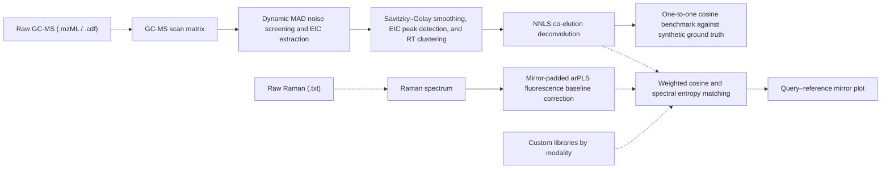

# Auto-SpectralLab

[](https://github.com/Sizisa/Auto-SpectralLab/actions/workflows/ci.yml)
[](https://www.python.org/downloads/)
[](LICENSE)

Auto-SpectralLab is an open-source research prototype for untargeted GC-MS
screening and Raman preprocessing. Commercial spectral software often hides
important preprocessing settings and offers limited batch automation. This
project exposes those settings in Python and uses reproducible tests to check
the effect of pipeline changes. It is also a demonstration project for using
Devin, an autonomous coding agent, to develop scientific analysis software
with measurable acceptance criteria.

## Architecture

The current prototype operates on NumPy arrays. It includes GC-MS component
perception, NNLS deconvolution, a ground-truth cosine benchmark, and Raman
fluorescence baseline correction. The dashed paths show the planned raw file
readers, custom library matching, and mirror plot output.



## Quickstart

From the cloned repository, create and activate a virtual environment.

```sh
python3 -m venv .venv
source .venv/bin/activate
python -m pip install -r requirements.txt
python prototype_deconv.py
pytest -v
```

On Windows PowerShell, activate the environment with
`.\.venv\Scripts\Activate.ps1`.

To correct the fluorescence baseline of an evenly spaced Raman spectrum,
pass its intensity column to `arpls`. The returned arrays have the same
length as the input.

```python
import numpy as np

from src.preprocessing.raman_arpls import arpls

raman_shift, intensity = np.loadtxt("raman.txt", unpack=True)
corrected, baseline = arpls(intensity, lam=1e5)
```

The sparse arPLS solver uses a second-difference penalty and logistic
reweighting based on negative residuals. Reflection at both ends reduces
edge artifacts. See [Baek et al., *Analyst* (2015)](https://doi.org/10.1039/C4AN01061B).

## Benchmark

Measured locally with Python 3.11.1, NumPy 2.4.6, SciPy 1.17.1, and pytest 9.2.0
on macOS arm64. The simulation uses 400 scans, 350 m/z bins, seed 42, and a
spacing of 0.45 FWHM between neighboring components. At the strongest ion
apex, the clean intensity divided by the combined Poisson shot noise and
Gaussian read noise standard deviation is 5.0, measured before zero clipping.

Deconvolution took **27.03 ms** and resolved **3 components**. Timing covers
deconvolution only and varies by machine. Matching is one-to-one, and the
benchmark requires every match to reach a cosine similarity of at least 0.92.

| Ground-truth compound | True RT (min) | Estimated RT (min) | Absolute RT error (min) | Cosine similarity | Status |
| --- | ---: | ---: | ---: | ---: | --- |
| Compound_A (Target_1) | 10.0000 | 10.0047 | 0.0047 | 0.9975 | `[PASS]` |
| Compound_B (Co-eluting_Isomer) | 10.1590 | 10.1734 | 0.0145 | 0.9970 | `[PASS]` |
| Compound_C (Matrix_Interference) | 10.3179 | 10.3159 | 0.0020 | 0.9963 | `[PASS]` |

`pytest -v` reported **4 passed in 0.74 s**. The Raman test checks baseline
and corrected-signal error as well as the recovered heights of peaks near
both ends of the spectrum. The current accuracy measurements are based on
synthetic data.

## Four-week roadmap

| Week | Deliverable |
| --- | --- |
| 1 | Release the GC-MS and Raman prototypes, document synthetic fixtures, and reproduce the benchmark in CI. |
| 2 | Add `.mzML`, ANDI-MS `.cdf`, and Raman `.txt` ingestion. Check retention-time units and compare exports from public instrument datasets. |
| 3 | Define custom GC-MS and Raman library formats. Implement tolerance-aware alignment, weighted cosine similarity, and spectral entropy scoring with modality-specific checks. |
| 4 | Add mirror plots and batch reports. Record a Devin-assisted change from issue through tested pull request and publish reproducibility instructions. |

## License

Released under the [MIT License](LICENSE).
